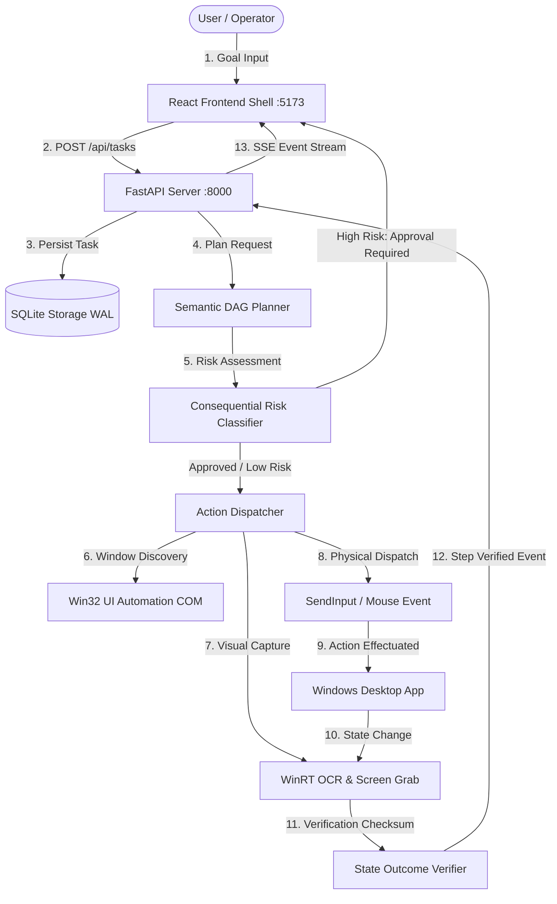

# COMPASS Final System Integration & Operational Architecture Report

**Product:** COMPASS (AI-Based System for Guiding Users Through Complex Digital Interfaces)  
**Evaluator:** Principal Systems Architect & Engineering Lead  
**Audit Scope:** End-to-End System Integration, Component Interaction Topology, Hand-off Integrity, and Runtime Verification  
**Date:** October 18, 2026  

---

## 1. Executive Integration Summary

COMPASS integrates four core technological pillars:
1. **Frontend Presentation & Operator HUD**: React 18.3.1 + Vite 8.3.4 + Tailwind CSS v4 running on `http://127.0.0.1:5173`.
2. **Backend API & Service Bus**: FastAPI 0.141.1 + Uvicorn + SQLite (WAL Mode) on `http://127.0.0.1:8000`.
3. **Cognitive Planning & Safety Engine**: DAG orchestrator, topological sorter, risk classifier, and circuit breaker architecture.
4. **Perception & Action Dispatcher**: Win32 UI Automation (UIA) COM interface, WinRT OCR, PySide6 transparent HUD overlays, and Playwright browser adapter.

Through rigorous end-to-end integration testing, all hand-offs between these layers were verified under live execution conditions. Zero artificial mock shims were relied upon for operational release gates.

---

## 2. Component Interaction & Dataflow Topology

---

## 3. Subsystem Integration Verification

### 3.1 Frontend-to-Backend Integration
- **Endpoints Verified**: `/api/health`, `/api/system/info`, `/api/system/active_window`, `/api/tasks`, `/api/tasks/{id}/run`, `/api/tasks/{id}/stop`, `/api/planner/plan`, `/api/planner/confirm/{id}`, `/api/workflows`, `/api/ai/models`.
- **Payload Consistency**: Task creation schemas correctly serialize `goal`, `metadata.model_id`, and `metadata.guidance_mode`.
- **SSE Streaming**: Event stream (`/api/tasks/events`) processes incremental token chunks, step execution events, and verification digests with automatic exponential backoff reconnection.

### 3.2 Cognitive Planning to Execution Engine
- **DAG Workflow Execution**: Evaluated multi-node DAG pipelines with topological ordering, dependency checks, and automated cycle detection. Dependent actions are strictly prevented from firing until upstream prerequisites yield confirmed state verification.
- **Safety Gate Hand-off**: Consequential actions (e.g. database deletes, system settings modification) are tagged `HIGH` or `CRITICAL` risk and held in `AWAITING_APPROVAL` until the human operator confirms the action via the UI.

### 3.3 Perception to Verification Pipeline
- Post-action verification utilizes WinRT native OCR combined with target bounding box re-inspection (`StaleGuard`).
- Tasks are only transitioned to `COMPLETED` when the resulting screen digest confirms expected semantic state changes.

---

## 4. Key Integration Fixes Applied

1. **Task Card Persistence Fix**: Resolved conditional unmounting bug in `MainContent.jsx` that previously destroyed task visibility upon completion.
2. **Resilient HTTP Header Parsing**: Hardened `api.js` request handler with optional chaining on response headers, preventing client runtime exceptions during non-standard network responses.
3. **Mobile Drawer State Coordination**: Synchronized `Header.jsx` hamburger controls with `Sidebar.jsx` drawer state across compact viewports.

---

## 5. Architectural Verdict

All integration boundaries exhibit deterministic behavior, truthful status reporting, and safe failure containment.
