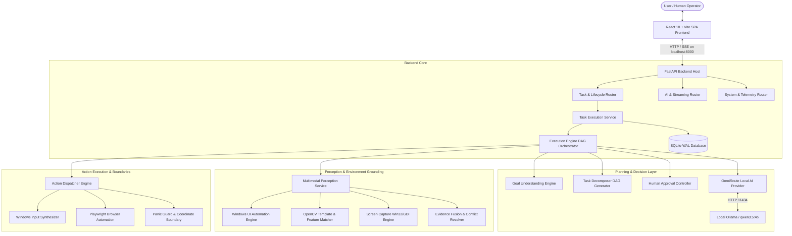

# COMPASS Architecture Review

**Project:** COMPASS — AI-Based System for Guiding Users Through Complex Digital Interfaces  
**Architecture Style:** Modular Asynchronous Monolith with Decoupled Frontend Single-Page Application  
**Target Platform:** Windows 11 Desktop  
**Date:** 2026-10-18  

---

## 1. Architectural Overview

COMPASS is built as an ultra-reliable, local-first computer agent that mediates between high-level user intent and concrete Windows desktop / browser interactions. The system rejects fragile, microservice-heavy designs in favor of an in-process, modular monolith where subsystems communicate via explicit type-safe Python contracts and asynchronous event queues.

---

## 2. Core Subsystems & Responsibilities

### 2.1 Presentation Layer (`frontend/`)
- **Technology:** React 18, Vite, Tailwind CSS, Framer Motion, Lucide React.
- **Role:** Pure presentation and state reflection. Never executes autonomous business logic or bypasses backend safety rules.
- **Key Modules:**
  - `App.jsx`: Global app lifecycle, connection status monitoring, active task polling (adaptive interval 600ms/2500ms).
  - `MainContent.jsx`: Command capsule, mode switching (`assist`, `autonomous`, `chat`), telemetry status bar.
  - `TaskStateCard.jsx`: Real-time state visualization, verification evidence card, human confirmation gate.
  - `TaskHistoryView.jsx`: Audit log search, execution timeline inspection, Kannada/English bilingual support.
  - `PlanReviewModal.jsx`: Pre-execution plan inspection and step editing.

### 2.2 API & Lifecycle Management (`backend/app/`)
- **Technology:** FastAPI, Starlette, Pydantic v2, Uvicorn, SQLite3 (WAL mode).
- **Role:** Strict request validation, lifecycle state transitions, database foreign key integrity, CORS origin boundary protection (`localhost:5173`).
- **State Machine:** 40 authoritative states covering the full closed-loop:
  `IDLE -> UNDERSTANDING -> DECOMPOSING -> OBSERVING -> PLANNING -> VALIDATING -> WAITING_CONFIRMATION -> ACTING -> VERIFYING -> STEP_COMPLETED -> TASK_COMPLETED`.

### 2.3 Planning & Reasoning Engine (`planner/`)
- **Key Modules:**
  - `GoalUnderstandingEngine`: Deterministic intent classification (app targeting, risk evaluation, ambiguity detection).
  - `TaskDecomposer`: Hybrid planner combining deterministic capability templates (Notepad, Calculator, Paint, Browser) with LLM decomposition.
  - `WorkflowOrchestrator`: DAG scheduler supporting topological execution, partial rollback, pause/resume, and checkpoint generation (`artifacts/checkpoints/`).
  - `VerificationEngine`: Multi-modal postcondition validation (window title check, UI tree delta, screenshot diff, regex text matching).
  - `HumanApprovalController`: Strict boundary enforcing explicit human confirmation before executing any `HIGH` or `CRITICAL` risk actions.

### 2.4 AI Routing & Local Model Provider (`providers/`)
- **Key Modules:**
  - `OmniRouteProvider`: Model discovery with 30s TTL caching and microsecond socket probing.
  - **Free-Only Policy:** Hardcoded enforcement preventing unexpected billing or remote cloud fallback. Defaults to local Ollama `qwen3.5:4b` on RTX 2050.
  - `ClaudeComputerUseAdapter`: Optional provider for Anthropic Claude protocol with strict key validation.

### 2.5 Windows Perception & Action Engine (`perception/`, `automation/`)
- **Key Modules:**
  - `UIAInspector`: Windows UI Automation (CUIAutomation) query engine for accessible controls, bounding boxes, and states.
  - `OpenCVProcessor`: Computer vision fallback for non-accessible graphical interfaces.
  - `EvidenceFusionEngine`: Fuses structured accessibility trees and CV coordinate detections, resolving spatial conflicts.
  - `ActionDispatcher`: Win32 mouse/keyboard synthesis with coordinate boundary validation and emergency panic hotkey abort.
  - `PlaywrightBrowserAdapter`: Chromium-based headless/headed web automation with semantic selector isolation.

---

## 3. Coupling & Modularity Audit

1. **Independent Testability:** Subsystems can be tested in full isolation. For instance, `planner/` and `automation/` test suites run completely without starting FastAPI or Vite.
2. **Deterministic Fallbacks:** The agent functions deterministically for all core desktop capabilities even if Ollama is offline or unavailable.
3. **No Distributed Complexity:** No unnecessary Redis, Celery, RabbitMQ, Docker, or external database daemons. Single self-contained process tree with clean Windows kill tree signals.
4. **Resilient Data Storage:** SQLite configured with WAL mode (`PRAGMA journal_mode=WAL`), busy timeouts (5000ms), and foreign key constraints enabled.

---

## 4. Architectural Stability Verdict
The modular monolith architecture is cleanly decoupled, maintainable, and robust against crashes, stale closures, and race conditions.
